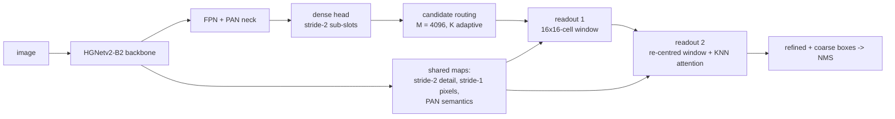

# CARE-Tiny

[](https://github.com/taxaceaee/care-tiny/actions/workflows/ci.yml)
[](LICENSE)


A **10.0M-parameter, ~62 GFLOPs** detector for tiny objects in aerial images. On the **AI-TOD-v2** test set it
reaches **33.7 AP** (very tiny objects: **20.3 APvt**), close to Dome-DETR-M (34.0 AP) with **2.4x fewer parameters
and 4x fewer FLOPs**.

## Results on AI-TOD-v2 test

Single model, single scale (800 x 800), single pass, no test-time augmentation. AP uses the AI-TOD protocol
(maxDets 1500; very tiny < 8 px, tiny 8-16 px, small 16-32 px, medium 32-64 px).

| Model | Params | GFLOPs | AP | AP50 | AP75 | APvt | APt | APs | APm |
|---|---:|---:|---:|---:|---:|---:|---:|---:|---:|
| Dome-DETR-M (paper) | 23.9M | 252.6 | 34.0 | 68.4 | 29.9 | 18.4 | 34.3 | 39.0 | 46.9 |
| Dome-DETR-L (paper) | 36.0M | 358.7 | 34.6 | 69.2 | 32.0 | 19.0 | 35.6 | 39.8 | 47.3 |
| **CARE-Tiny**, best test epoch (115) | **10.0M** | **61.7** | 33.7 | 67.6 | 29.7 | **20.3** | **34.5** | 38.1 | 45.8 |
| **CARE-Tiny**, last epoch (160) | **10.0M** | **61.7** | 33.2 | 66.8 | 28.9 | **20.2** | 34.0 | 37.3 | 45.3 |

Per class (epoch 115): airplane 47.2, bridge 24.6, storage-tank 45.1, ship 55.1, swimming-pool 31.5, vehicle 35.9,
person 19.9, wind-mill 10.4. AR1500 48.2, oLRP 69.5.

- **Protocol.** Trained on trainval, evaluated on test. "Best test epoch" follows Dome-DETR / D-FINE, which score
  the EMA on the test split after every epoch and report the best epoch; "last epoch" is the protocol of the
  official AI-TOD-v2 baselines. Epochs 101-121 all score 33.5-33.7, so the best epoch is not an outlier.
- **GFLOPs** at 800 x 800 with K = 256 refined queries (60.9 at K = 128, 66.4 at K = 1024; K is chosen per image
  from the estimated object count). Dome-DETR numbers are quoted from its paper.
- **Logs** of the run (every test evaluation, loss curves, configuration, environment) are in
  [results/aitodv2_b2_seed0](results/aitodv2_b2_seed0).

## How it works



- **Dense periphery, sparse refinement.** A cheap dense head on a stride-2 sub-slot grid finds candidates; only K of
  them (128-2048, from the estimated object count) are refined, so the expensive part scales with the number of
  objects, not the number of pixels.
- **Pixel-grounded boxes.** Each readout samples a 16 x 16-cell window from shared maps (stride-2 detail, stride-1
  pixels, PAN semantics) and predicts every box edge as a distribution over the window's cell boundaries, so a
  2-8 px object is localised on the pixel grid.
- **Cascade.** The second readout re-centres its window on the first readout's box, and its queries first attend to
  their 16 nearest neighbours (one-to-one assignment, duplicates suppressed before NMS).
- **Training.** Task-aligned assignment with NWD for small objects, quality focal loss with an IoU / NWD target,
  denoising queries, repeat-factor sampling and copy-paste of rare classes, EMA, flat-cosine schedule.

## Installation

```bash
git clone https://github.com/taxaceaee/care-tiny.git
cd care-tiny
pip install -e .            # or: pip install -r requirements.txt
```

Requires Python 3.10+, PyTorch 2.4+ and timm 1.0.9+ (the HGNetv2-B2 ImageNet weights are downloaded by timm on the
first training run).

## Data

Download [AI-TOD-v2](https://chasel-tsui.github.io/AI-TOD-v2/) and arrange it in the official layout:

```
aitodv2/
  annotations/aitodv2_{train,val,trainval,test}.json
  images/trainval/*.png
  images/test/*.png
```

Check the copy against the official release (image / box counts, SHA-256 of the annotation files, split
consistency; `--full` also decodes every image):

```bash
python tools/verify_dataset.py --root /data/aitodv2
```

## Usage

**Pretrained weights** (EMA of epoch 115, 33.7 AP, 38.7 MiB) from the
[v1.0.0 release](https://github.com/taxaceaee/care-tiny/releases/tag/v1.0.0):

```bash
mkdir -p weights
curl -L -o weights/care_tiny_b2_aitodv2_ep115.pth \
    https://github.com/taxaceaee/care-tiny/releases/download/v1.0.0/care_tiny_b2_aitodv2_ep115.pth
# sha256: ff7286e7e47d0b18d78c61b66db0ce67e53dd5bf678963330e8ce97a0412161d
```

The file holds only tensors and plain containers and loads with `torch.load(..., weights_only=True)`.

**Evaluate** a checkpoint on the test split (writes all metrics and per-class AP):

```bash
python tools/test.py --checkpoint weights/care_tiny_b2_aitodv2_ep115.pth --data-root /data/aitodv2
```

**Detect** objects in your own images (JSON + drawings):

```bash
python tools/infer.py --checkpoint weights/care_tiny_b2_aitodv2_ep115.pth --input path/to/images --score-thr 0.3
```

**Train** (one GPU; the released model took ~16.5 h on an RTX PRO 6000 including 60 test evaluations, ~24 GB of
GPU memory at batch 16; re-running the same command resumes from `checkpoints/last.pth`):

```bash
python tools/train.py --config configs/care_tiny_b2_aitodv2.yaml --data-root /data/aitodv2 --output-dir runs/b2
torchrun --nproc_per_node=2 tools/train.py --config configs/care_tiny_b2_aitodv2.yaml --data-root /data/aitodv2 \
    --output-dir runs/b2
```

To train on train, select on val and test once (no test-set selection), add `configs/protocol_train_val.yaml`.
Any key can be overridden, e.g. `--opts train.batch_size=8 data.num_workers=4`. GPUs without bf16 (e.g. T4, V100)
need `--opts train.amp_dtype=fp16`.

**Benchmark** parameters, GFLOPs and latency: `python tools/benchmark.py --k 128 256 1024`.

## Reproducibility

- `configs/care_tiny_b2_aitodv2.yaml` is the exact recipe of the released model (seed 0, batch 16, 160 epochs =
  120 with strong augmentation + 40 without). This code was checked to reproduce the research code that trained
  it bit for bit on CPU: parameters and initialisation, forward outputs, losses, gradients, augmentations, sampler
  order, a short end-to-end training run with the test protocol, and the 170 keys of the run's
  `config_resolved.json` (which uses the research code's key names).
- **Known issue, kept for reproducibility:** the class weights of the loss use the box counts in
  `criterion.AITOD_BOX_COUNTS_LEGACY`, which are not the AI-TOD-v2 trainval counts (e.g. airplane 14 325 instead of
  843). `--opts loss.class_counts=data` uses the counts of the training split instead; it has not been trained at the
  full schedule.

## Repository layout

```
care_tiny/      model, losses, label assignment, data + augmentation, training engine, AI-TOD evaluator
configs/        released recipe and the train/val protocol overlay
tools/          train.py, test.py, infer.py, benchmark.py, verify_dataset.py
tests/          unit and end-to-end tests (pytest, CPU, ~1 min)
results/        logs of the released run
```

Run the tests with `pip install -e ".[dev]" && pytest`.

## Acknowledgements

The evaluation follows [cocoapi-aitod](https://github.com/jwwangchn/cocoapi-aitod) (and is unit-tested against
pycocotools); the test protocol follows [Dome-DETR](https://github.com/RicePasteM/Dome-DETR) and
[D-FINE](https://github.com/Peterande/D-FINE); the backbone is HGNetv2 from [timm](https://github.com/huggingface/pytorch-image-models).
Dataset: [AI-TOD-v2](https://chasel-tsui.github.io/AI-TOD-v2/).

## Citation

```bibtex
@software{care_tiny_2026,
  title  = {CARE-Tiny: a 10M-parameter detector for tiny objects in aerial images},
  year   = {2026},
  url    = {https://github.com/taxaceaee/care-tiny}
}
```

## License

[Apache-2.0](LICENSE). The AI-TOD-v2 dataset is not part of this repository and has its own terms.
